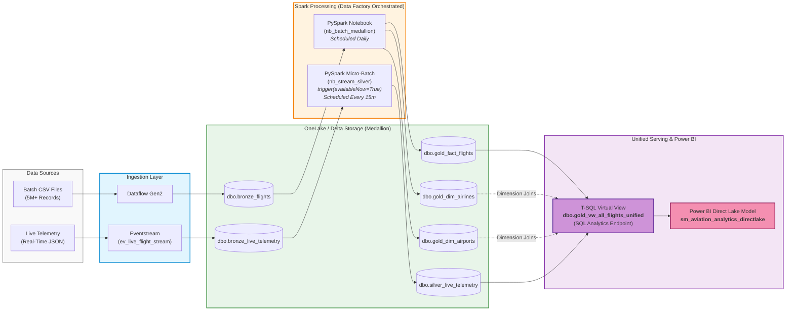

# ✈️ Automated End-to-End Aviation Analytics Platform

**Unified Medallion Architecture on Microsoft Fabric (F2 Capacity Optimized)**

## 📌 Project Overview & Intent

The objective of this project is to build an automated, end-to-end Aviation Analytics platform on **Microsoft Fabric** using an **F2 Capacity**. The platform unifies **5M+ historical batch records** with continuous **real-time streaming telemetry** into a single Power BI Direct Lake reporting layer.

By combining a Medallion Architecture (Bronze $\rightarrow$ Silver $\rightarrow$ Gold) with a virtualized T-SQL abstraction layer, this system delivers immediate visibility into flight delays, fleet operations, and performance metrics without data duplication or capacity overages.

---

## 🏗️ End-to-End System Architecture




## 🧰 Tools & Microsoft Fabric Components Used

| Component / Tool | Role in Architecture | Technical Details & Configuration |
| --- | --- | --- |
| **Microsoft Fabric F2 Capacity** | Core Infrastructure | Shared, serverless compute environment optimized to manage workloads under capacity limits. |
| **Dataflow Gen2** | Batch Ingestion | Extracts and loads 5M+ historical CSV records into Delta Lake storage. |
| **Fabric Eventstream** | Streaming Ingestion | Ingests real-time JSON flight telemetry into raw Bronze Lakehouse tables. |
| **PySpark Notebooks** | Data Transformation | Handles schema enforcement, cleansing, delay metric logic, and schema padding. |
| **Delta Lake (OneLake)** | Storage Layer | Open-format Parquet storage with ACID transactions across Medallion layers. |
| **SQL Analytics Endpoint** | Virtualization & Views | Hosts T-SQL views to merge historical batch facts with live streaming telemetry. |
| **Data Factory Pipelines** | Workflow Orchestration | Decouples and automates daily historical batch runs and 15-minute streaming micro-batches. |
| **Power BI (Direct Lake)** | Analytics & Reporting | Direct Lake Semantic Model providing sub-second dashboard updates directly over OneLake Parquet storage. |

---

## 💡 Architectural Choices & Technical Rationale

## 💡 Architectural Choices & Technical Rationale

### 1. Unified Layer: T-SQL Virtual View vs. Physical Delta MERGE

* **Challenge:** Merging live streaming records directly into the 5M+ row historical fact Delta table causes storage duplication and write-lock collisions (concurrency errors) when batch and streaming pipelines execute simultaneously.
* **Decision:** Implemented a T-SQL `UNION ALL` view (`dbo.gold_vw_all_flights_unified`) in the SQL Analytics Endpoint instead of physically writing streaming records into `gold_fact_flights`.
* **Rationale:**
  * **Zero Storage Duplication:** Eliminates double-storing streaming records inside historical batch tables.
  * **Prevents Write Lock Contention:** Avoids Delta Lake write-lock collisions when batch and streaming jobs write to storage at the same time.
  * **Instant Visibility:** Telemetry written to `silver_live_telemetry` is immediately exposed in Power BI reports without requiring heavy batch reprocessing.

---

### 2. Streaming Strategy: Micro-Batch (`availableNow=True`) vs. Continuous Streaming

* **Challenge:** Continuous interactive Spark streaming jobs hold active Compute Units (CUs) indefinitely, causing `HTTP 430: TooManyRequestsForCapacity` throttling errors on an F2 SKU capacity.
* **Decision:** Configured PySpark Structured Streaming using `.trigger(availableNow=True)` executed via scheduled Data Factory pipelines rather than running persistent `writeStream` jobs.
* **Rationale:**
  * **Capacity Optimization (F2 SKU):** Eliminates persistent CU consumption, keeping the workload within F2 capacity limits.
  * **Safe Resource Release:** Micro-batching processes accumulated telemetry in 20–30 seconds, writes checkpoint state, and shuts down compute safely.

---

### 3. Orchestration: Decoupled Data Factory Pipelines

* **Challenge:** Combining resource-heavy daily batch transformations with high-frequency (15-minute) streaming jobs in a single pipeline leads to execution bottlenecks and cascading failure risks.
* **Decision:** Built two independent Data Factory pipelines (`Batch_ingestion_bronze` and `Stream_ingestion_silver`).
* **Rationale:**
  * **Isolated Execution Schedules:** Isolates heavy daily batch execution from high-frequency streaming micro-batches.
  * **Fault Isolation:** Telemetry stream network drops or source failures will not stall or block daily historical batch processing.

---

### 4. Semantic Layer: Direct Lake Mode

* **Challenge:** Traditional Power BI Import mode requires scheduled dataset refreshes that introduce reporting latency, while DirectQuery causes slow query performance on large datasets.
* **Decision:** Connected Power BI directly to OneLake Delta Parquet tables using **Direct Lake** mode.
* **Rationale:**
  * **Zero Refresh Latency:** Eliminates scheduled Power BI dataset refreshes—visuals update automatically as soon as streaming micro-batches write to Delta storage.
  * **Import-Level Performance:** Reads Parquet files directly from OneLake with sub-second query performance without loading data into memory.


---

## 🛠️ Step-by-Step Implementation Guide

### Step 1: Medallion Storage & Schema Design

* Provisioned `Aviation_Lakehouse` in Fabric.
* Configured target schemas:
* `dbo.bronze_flights` / `dbo.bronze_live_telemetry`: Raw landing tables.
* `dbo.silver_live_telemetry`: Cleansed, schema-padded telemetry with standardized delay metrics.
* `dbo.gold_fact_flights` & Dimensions: Historical fact and dimension tables (`gold_dim_airlines`, `gold_dim_airports`).

### Step 2: Historical Batch Pipeline Construction

* Configured Dataflow Gen2 to land 5M+ historical flight records.
* Implemented `nb_batch_medallion` to process Bronze data into Gold dimensional models.

### Step 3: Streaming Telemetry Processing

* Configured Fabric Eventstream (`ev_live_flight_stream`) to route incoming flight telemetry JSON into `dbo.bronze_live_telemetry`.
* Developed `nb_stream_silver` using PySpark Structured Streaming with `.trigger(availableNow=True)` and `.toTable("dbo.silver_live_telemetry")`.

### Step 4: Virtual Layer Unification

* Executed T-SQL in the SQL Analytics Endpoint to generate the unified view:

### Step 5: Data Factory Pipeline Orchestration

* Created **`Batch_ingestion_bronze`**: Sequenced Dataflow Gen2 $\rightarrow$ Batch Notebook, scheduled Daily at 02:00 AM.
* Created **`Stream_ingestion_silver`**: Single Notebook activity running `nb_stream_silver`, scheduled on a 15-minute recurring trigger.

### Step 6: Power BI Direct Lake Semantic Modeling

* Created custom semantic model `sm_aviation_analytics_directlake` from the SQL Analytics Endpoint selecting `gold_vw_all_flights_unified` and dimensions.
* Established $1:*$ relationships from dimensions to the unified view.
* Built DAX operational measures (`Total Flights`, `Delayed Flights`, `% On-Time Performance`, `Avg Departure Delay`).
```
