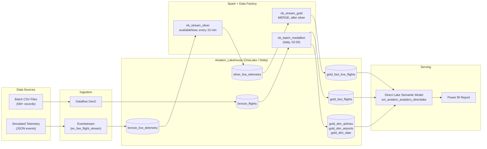

# ✈️ End-to-End Aviation Analytics Platform on Microsoft Fabric

**Medallion architecture (Bronze → Silver → Gold) unifying 5M+ historical flight records with simulated near-real-time telemetry, served through a Power BI Direct Lake semantic model. Built to run on a small F2 capacity.**

---

## 📌 Overview

This project is a self-built, end-to-end data engineering and analytics platform on **Microsoft Fabric (F2 capacity)**. It combines:

- **Batch:** 5M+ historical flight records loaded with Dataflow Gen2 and transformed with PySpark.
- **Streaming:** simulated JSON flight telemetry ingested through Eventstream and processed with Spark Structured Streaming micro-batches.
- **Serving:** a Direct Lake semantic model where historical and live facts share the same dimensions and are unified with DAX measures.

> **Note on data:** the live telemetry is produced by a data generator, not a real flight feed. "Real-time" here means near-real-time: data becomes visible after the next 15-minute micro-batch.

---

## 🏗️ Architecture

Historical and live data are **never physically merged**. They live in two Gold fact tables that share the same dimensions, and the semantic model unifies them in DAX.

---

## 🧰 Tech Stack

| Component | Role |
| --- | --- |
| **Microsoft Fabric F2** | Capacity the whole platform runs on |
| **Dataflow Gen2** | Batch ingestion of historical CSVs into Delta |
| **Eventstream** | Streaming ingestion of JSON telemetry into Bronze |
| **PySpark / Structured Streaming** | Cleansing, schema enforcement, delay logic, Silver and Gold loads |
| **Delta Lake (OneLake)** | Storage with ACID transactions across all layers |
| **Data Factory pipelines** | Orchestration of batch and streaming jobs |
| **SQL analytics endpoint** | T-SQL access for validation and ad hoc queries |
| **Power BI (Direct Lake) + DAX** | Semantic model and report |

---

## 🗂️ Data Model

| Layer | Table | Description |
| --- | --- | --- |
| Bronze | `bronze_flights` | Raw historical records |
| Bronze | `bronze_live_telemetry` | Raw telemetry events from Eventstream |
| Silver | `silver_live_telemetry` | Cleansed, typed telemetry with `flight_date`, delay flags and audit columns |
| Gold | `gold_fact_flights` | Historical fact table |
| Gold | `gold_fact_live_flights` | Live fact table, deduplicated with a deterministic key |
| Gold | `gold_dim_airlines`, `gold_dim_airports`, `gold_dim_date` | Shared dimensions |

---

## 💡 Design Decisions

### 1. Two fact tables unified in the semantic model (not one merged table, not a view)

- **Challenge:** Live and historical data needed to appear in the same reports, but writing streaming rows into the 5M+ row batch fact table would couple two pipelines with different cadences and force frequent writes to a large table.
- **Initial approach:** A T-SQL `UNION ALL` view over both sources, used as the semantic model source.
- **Problem found:** Direct Lake reads Delta tables, not views. A model built on a view falls back to **DirectQuery**, re-running the joins over 5M+ rows on every visual and defeating the purpose of Direct Lake.
- **Final design:** Model `gold_fact_flights` and `gold_fact_live_flights` as separate Direct Lake tables sharing the same dimensions, and combine them with DAX measures (for example `Total Flights = [Batch Flights] + [Live Flights]`). Fallback is set to **Direct Lake only** so any silent fallback surfaces as an error.
- **Result:** No duplicated data, independent batch and streaming pipelines, and queries served from Delta files. *(Add measured before/after query times here.)*

### 2. Micro-batch streaming (`availableNow=True`) instead of continuous streaming

- **Challenge:** A continuously running Spark streaming job holds compute indefinitely, which risks capacity throttling (`HTTP 430`) on an F2 SKU.
- **Decision:** Structured Streaming with `.trigger(availableNow=True)`, run on a 15-minute schedule by Data Factory.
- **Result:** Each run processes whatever has accumulated, checkpoints its progress, and releases compute. The trade-off is latency of up to 15 minutes instead of seconds.

### 3. Idempotent Silver → Gold with Delta MERGE

- **Challenge:** Eventstream delivery and pipeline reruns can produce duplicates, and the telemetry has no unique event ID.
- **Decision:** `nb_stream_gold` uses `foreachBatch` with a `MERGE` on a hash key (flight number, airline, event timestamp), inserting only new rows.
- **Result:** Re-running the pipeline without new events leaves row counts unchanged.

### 4. Decoupled pipelines with a clear dependency chain

- `Batch_ingestion_bronze`: Dataflow Gen2 → `nb_batch_medallion`, daily at 02:00.
- `Stream_ingestion_silver`: `nb_stream_silver` → `nb_stream_gold` (runs on success of silver), every 15 minutes.
- Batch and streaming run independently, so a telemetry failure never blocks the daily historical load. Inside the streaming pipeline, Gold only runs when Silver succeeds.

### 5. Direct Lake semantic layer

- Direct Lake avoids scheduled import refreshes and avoids DirectQuery's per-query cost. Needed columns are loaded from Delta/Parquet into memory on demand and refreshed when the underlying tables change (reframing), so new micro-batch data appears shortly after it lands rather than instantly.

---

## 🛠️ Implementation Walkthrough

1. **Lakehouse and schemas:** created `Aviation_Lakehouse` with Bronze, Silver and Gold tables.
2. **Batch pipeline:** Dataflow Gen2 lands 5M+ records into `bronze_flights`; `nb_batch_medallion` builds `gold_fact_flights`, the dimensions, and `flight_date`.
3. **Streaming ingestion:** Eventstream `ev_live_flight_stream` writes telemetry JSON to `bronze_live_telemetry`.
4. **Silver:** `nb_stream_silver` casts types, standardizes keys, derives `event_timestamp` and `flight_date`, computes delay flags, pads the schema for batch compatibility, and stamps `silver_ingestion_timestamp`.
5. **Gold:** `nb_stream_gold` upserts into `gold_fact_live_flights` and optionally builds an hourly aggregate.
6. **Orchestration:** two Data Factory pipelines with the schedules above.
7. **Semantic model:** `sm_aviation_analytics_directlake` with five tables, 1:* relationships from each dimension to both fact tables, inactive destination relationships activated through `USERELATIONSHIP`, and fallback set to Direct Lake only.
